<p align="center">
  
  
  
  
  
  
</p>

<h1 align="center">🛡️ TrafficWatch</h1>
<h3 align="center">Real-Time Road Incident & Safety Pipeline</h3>

<p align="center">
  <em>An enterprise-grade distributed Big Data pipeline for road safety monitoring, incident classification, and parallel computing benchmarking — powered by Hadoop, Spark, and real-time TomTom telemetry.</em>
</p>

---

## 🌐 Overview

**TrafficWatch** is a full-stack distributed analytics platform that ingests live road incident data from the **TomTom Traffic API v5**, stores it in **Hadoop HDFS**, processes it through **PySpark batch and streaming engines**, and presents insights through a professional **Flask dashboard** with interactive maps, severity charts, and blackspot detection grids.

The pipeline covers two simultaneous geographic zones:

| Zone | Coverage | Purpose |
|------|----------|---------|
| 🌍 **Global Transit Corridor** | London Metro Area | Baseline high-density reference feed |
| 🇵🇰 **Pakistan Motorway Network** | M-2, GT Road, Lahore, Islamabad, Karachi | Targeted national road safety analysis |

> **Dual-Mode Engine** — The dashboard operates seamlessly whether Hadoop/HDFS is online (**HDFS Cluster Synced** mode) or offline (**Dynamic Local Fallback** mode), ensuring immediate interactivity under all configurations.

---

## ✨ Key Features

<table>
<tr>
<td width="50%">

### 🔄 Data Ingestion
- Real-time TomTom API v5 incident consumption
- Dual bounding-box queries (Global + Pakistan)
- Automatic fallback projection engine for Pakistan motorway grids when live data is sparse

</td>
<td width="50%">

### 💾 Distributed Storage
- Hadoop HDFS as the storage backbone
- Raw incident logs at `/traffic_watch/raw/`
- Analytical outputs at `/traffic_watch/output/`

</td>
</tr>
<tr>
<td width="50%">

### ⚡ Batch Processing
- PySpark SQL for parallelized grouping & classification
- Traffic Class mapping (Minor → Major Multi-Vehicle Pileup)
- Top 10 dangerous corridors, crash type breakdowns
- Regional statistics (Global vs Pakistan)

</td>
<td width="50%">

### 🔥 Blackspot Detection
- 0.1° grid aggregation (~10km × 10km cells)
- Density-based risk classification
- Labels: `CRITICAL BLACKSPOT` → `LOW RISK AREA`

</td>
</tr>
<tr>
<td width="50%">

### 📡 Real-Time Streaming
- TCP socket simulator (port 9999) for live telemetry feed
- PySpark Structured Streaming micro-batch consumer
- Critical alert flagging (severity > 7.0)
- Automatic HDFS Parquet archival

</td>
<td width="50%">

### 📊 Amdahl's Law Benchmark
- Empirical scaling experiments across 1, 2, and 4 CPU cores
- Theoretical vs actual speedup plotting (P = 0.85)
- Core efficiency analysis

</td>
</tr>
</table>

---

## 🖥️ Dashboard Preview

The TrafficWatch dashboard is a professional, single-page interface built with Flask, Leaflet.js, Chart.js, and Bootstrap 5.3.

<details>
<summary><b>📸 Click to expand Dashboard Screenshots</b></summary>

<br>

| Section | Preview |
|---------|---------|
| **About & Architecture** | 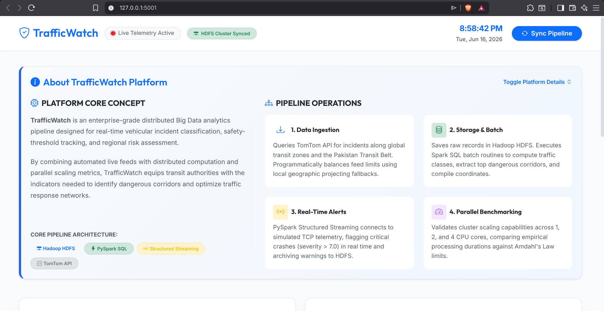 |
| **KPI Cards** | 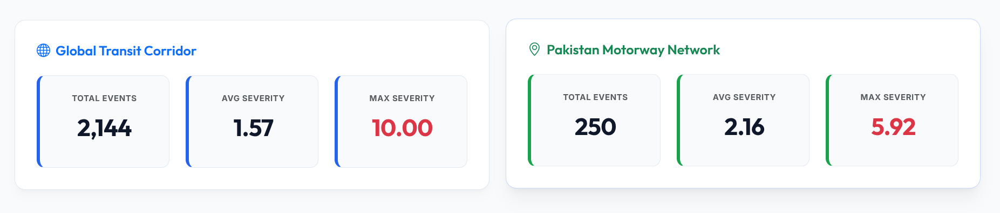 |
| **Live Incident Map & Traffic Classes** | 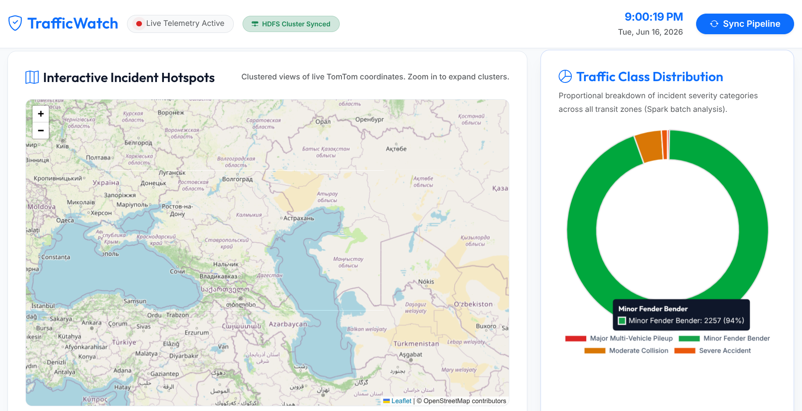 |
| **Dangerous Corridors & Crash Types** | 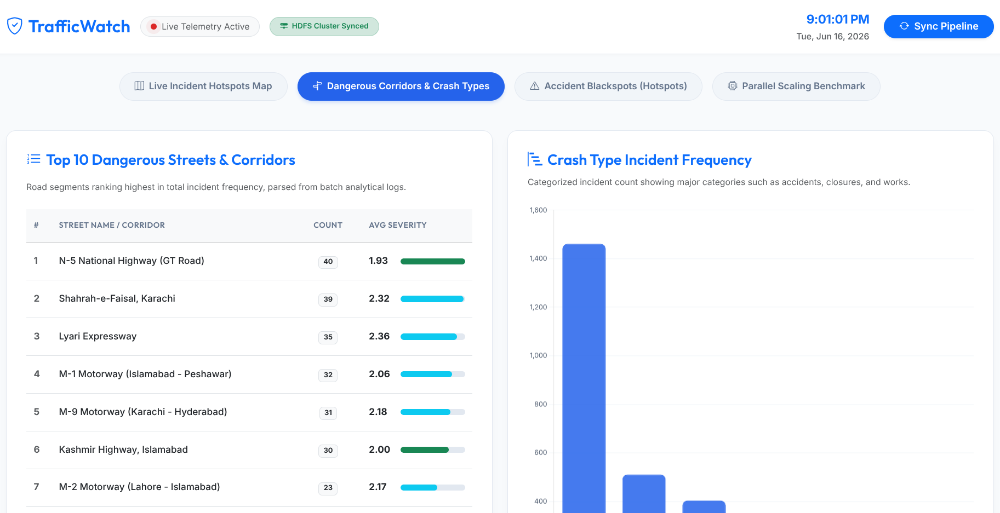 |
| **Accident Blackspots Grid** | 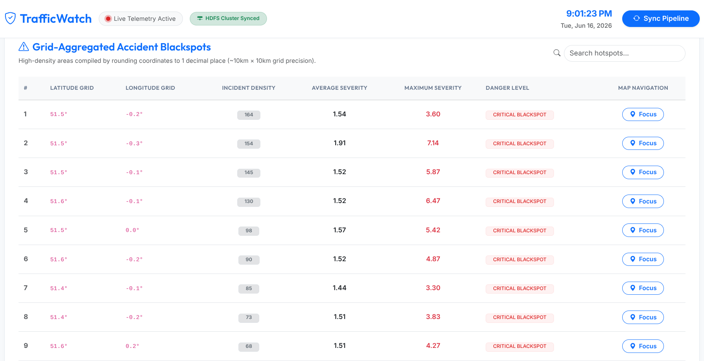 |
| **Amdahl's Law Benchmark** | 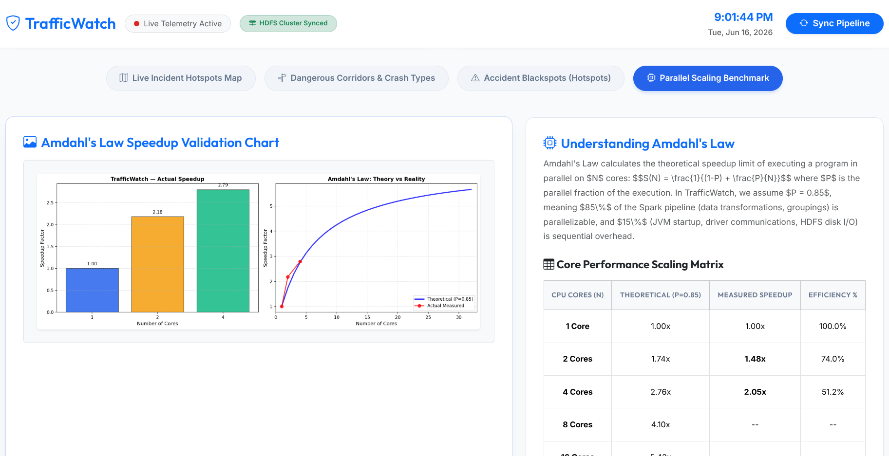 |
| **Core Scaling Matrix** | 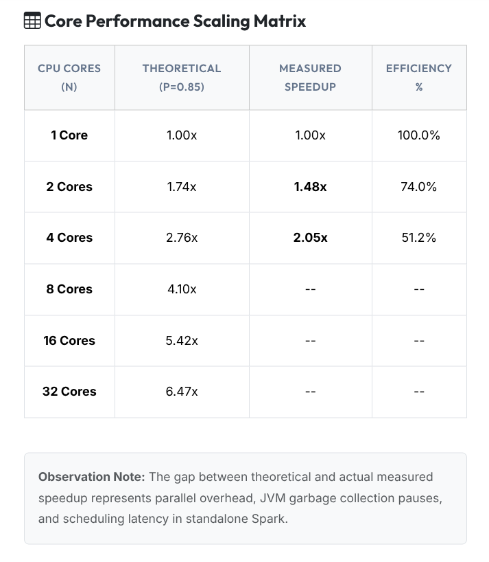 |

</details>

---

## 🏗️ Architecture

```
                    ┌──────────────────────────────┐
                    │    TomTom Traffic API v5      │
                    │   (Live Incident Telemetry)   │
                    └──────────────┬───────────────┘
                                   │
                    ┌──────────────▼───────────────┐
                    │   01_download_data.py         │
                    │   API Ingestion + Fallback    │
                    │   Projection Engine           │
                    └──────────────┬───────────────┘
                                   │
              ┌────────────────────▼────────────────────┐
              │          data/traffic_accidents.csv      │
              └────────────────────┬────────────────────┘
                                   │
                    ┌──────────────▼───────────────┐
                    │   02_upload_hdfs.sh           │
                    │   HDFS Directory Setup &      │
                    │   CSV Upload                  │
                    └──────────────┬───────────────┘
                                   │
              ┌────────────────────▼────────────────────┐
              │          Hadoop HDFS Cluster             │
              │   /traffic_watch/raw/                    │
              │   /traffic_watch/output/                 │
              └───┬─────────────┬──────────────┬────────┘
                  │             │              │
    ┌─────────────▼──┐  ┌──────▼──────┐  ┌───▼──────────────┐
    │ 03_batch_       │  │ 04_hotspot  │  │ 05_stream_feed   │
    │ analysis.py     │  │ .py         │  │ .py (TCP:9999)   │
    │                 │  │             │  │        │         │
    │ Traffic Classes │  │ Blackspot   │  │        ▼         │
    │ Region Stats    │  │ Detection   │  │ 06_stream_alert  │
    │ Top Streets     │  │ Risk Levels │  │ .py              │
    │ Crash Types     │  │             │  │ Critical Alerts  │
    └────────┬────────┘  └──────┬──────┘  └────────┬─────────┘
             │                  │                   │
             └──────────────────┼───────────────────┘
                                │
                    ┌───────────▼────────────┐
                    │   07_amdahl.py          │
                    │   Scaling Benchmark     │
                    │   (1, 2, 4 cores)       │
                    └───────────┬────────────┘
                                │
                    ┌───────────▼────────────┐
                    │       app.py            │
                    │   Flask REST API &      │
                    │   Interactive Dashboard │
                    │   (Dual-Mode Engine)    │
                    └────────────────────────┘
```

---

## 🛠️ Technology Stack

| Layer | Technology |
|-------|-----------|
| **Language** | Python 3.10+ |
| **Processing Engine** | Apache Spark 4.1.1 (PySpark SQL, Structured Streaming) |
| **Storage** | Hadoop HDFS 3.4.x |
| **Data Serialization** | CSV, Apache Parquet |
| **Backend** | Flask 3.1.3 |
| **Frontend** | HTML5, Vanilla CSS, Bootstrap 5.3, Bootstrap Icons |
| **Mapping** | Leaflet.js + Marker Clustering |
| **Charts** | Chart.js (Doughnut, Bar) |
| **API Provider** | TomTom Traffic API v5 |
| **Operating System** | Fedora Linux 43 |

---

## 📁 Repository Structure

```
TrafficWatch/
├── app.py                          # Flask backend — REST API & dashboard server
├── requirements.txt                # Runtime dependencies (Flask, Pandas, Requests)
├── requirements-pipeline.txt       # Pipeline dependencies (PySpark, Matplotlib)
│
├── scripts/                        # Modular pipeline scripts (sequential execution)
│   ├── 01_download_data.py         #   TomTom API ingestion + fallback projections
│   ├── 02_upload_hdfs.sh           #   Hadoop daemon check + HDFS CSV upload
│   ├── 03_batch_analysis.py        #   PySpark batch: classes, regions, streets, types
│   ├── 04_hotspot.py               #   PySpark blackspot grid aggregation
│   ├── 05_stream_feed.py           #   TCP socket simulator (live telemetry)
│   ├── 06_stream_alert.py          #   PySpark Structured Streaming alert consumer
│   └── 07_amdahl.py                #   Amdahl's Law benchmark (1/2/4 cores)
│
├── templates/
│   └── index.html                  # Single-page interactive dashboard
│
├── data/
│   └── traffic_accidents.csv       # Raw incident dataset (auto-generated)
│
├── output/
│   └── speedup_chart.png           # Amdahl benchmark visualization
│
└── docs/                           # Documentation & evidence
    ├── Traffic_Watch_Report.pdf     #   Formal project report
    ├── hadoop_spark_installation_manual.pdf
    └── screenshots/
        ├── hadoop-spark-setup/     #   Hadoop & Spark installation evidence
        └── pipeline-execution/     #   Full pipeline execution screenshots
```

---

## 🚀 Quick Start

### Prerequisites

| Requirement | Version |
|------------|---------|
| Python | 3.10+ |
| Java JDK | 17+ |
| Apache Hadoop | 3.4.x |
| Apache Spark | 4.1.x |
| TomTom API Key | [Free Developer Key](https://developer.tomtom.com/) |

### Phase 1 — Environment Setup

```bash
# Create and activate virtual environment
python3 -m venv .venv
source .venv/bin/activate

# Install dependencies
pip install -r requirements.txt
pip install -r requirements-pipeline.txt

# Export your TomTom API key
export TOMTOM_KEY=your_actual_tomtom_api_key
```

### Phase 2 — Data Ingestion

```bash
# Download incidents from TomTom API (saves to data/traffic_accidents.csv)
python scripts/01_download_data.py
```

<details>
<summary>📸 Ingestion Output</summary>

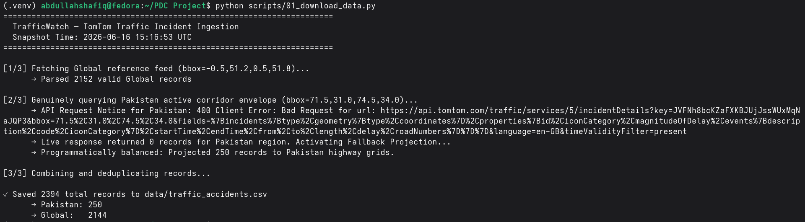

</details>

### Phase 3 — Hadoop & Spark Processing

```bash
# Start Hadoop daemons
start-dfs.sh
start-yarn.sh

# Verify services
jps  # Should show: NameNode, DataNode, ResourceManager

# Upload data to HDFS
bash scripts/02_upload_hdfs.sh

# Run PySpark batch analysis
spark-submit scripts/03_batch_analysis.py

# Run blackspot detection
spark-submit scripts/04_hotspot.py
```

<details>
<summary>📸 Batch Processing Evidence</summary>

| Step | Screenshot |
|------|-----------|
| Hadoop Start | 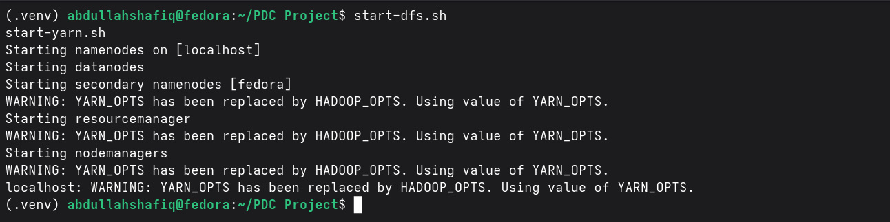 |
| JPS Verification | 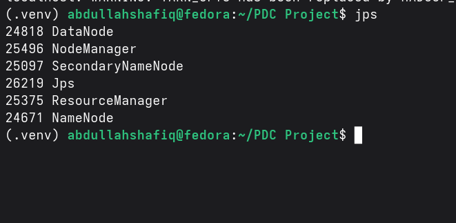 |
| HDFS Upload | 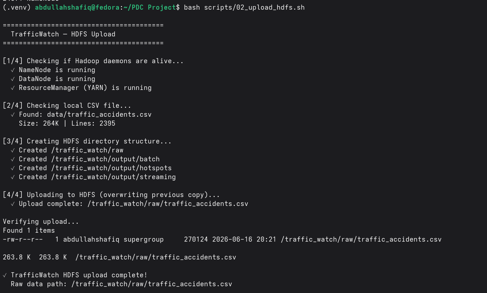 |
| Batch Results | 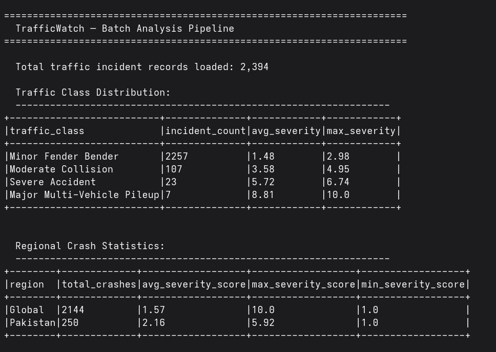 |
| Blackspots | 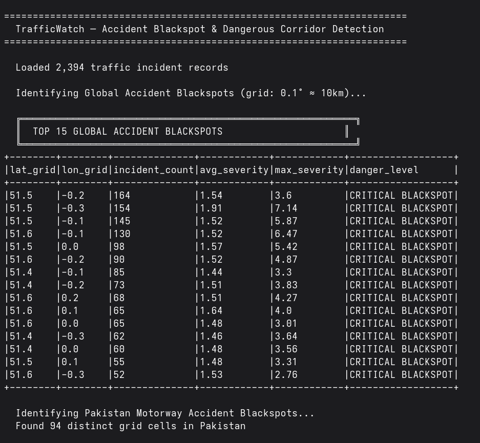 |

</details>

### Phase 4 — Real-Time Streaming

```bash
# Terminal 1: Start TCP stream simulator
source .venv/bin/activate
python scripts/05_stream_feed.py

# Terminal 2: Start Spark streaming consumer
source .venv/bin/activate
spark-submit scripts/06_stream_alert.py
```

> Events with `severity_score > 7.0` trigger **CRITICAL TRAFFIC INCIDENT** alerts and are archived to HDFS Parquet.

<details>
<summary>📸 Streaming Evidence</summary>

| Step | Screenshot |
|------|-----------|
| Feed Simulator | 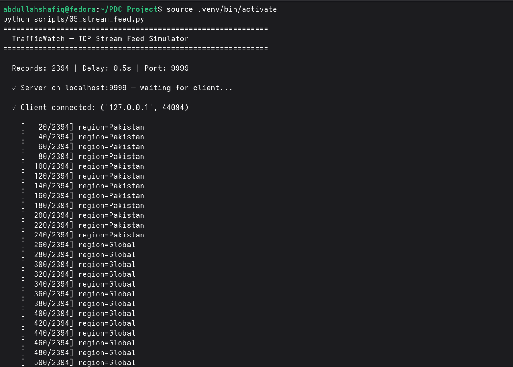 |
| Alert Batches | 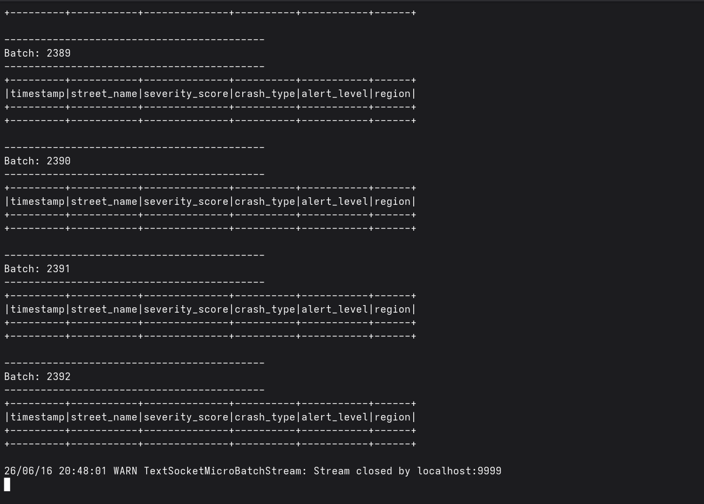 |

</details>

### Phase 5 — Performance Benchmark

```bash
# Run Amdahl's Law scaling benchmark (1, 2, 4 cores)
python scripts/07_amdahl.py
```

<details>
<summary>📸 Benchmark Results</summary>

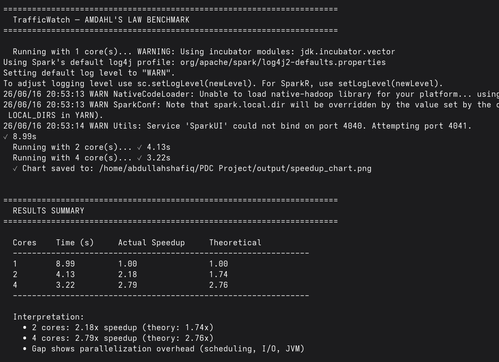

</details>

### Phase 6 — Launch Dashboard

```bash
# Start the Flask server
python app.py
```

Navigate to **http://localhost:5001/** to view the interactive dashboard.

> [!NOTE]
> The Flask server includes a **Dual-Mode Data Engine**. If Hadoop/HDFS is active, it queries pre-processed HDFS files and displays the **HDFS Cluster Synced** badge. If HDFS is offline, the server automatically computes analytics from the local CSV and displays the **Dynamic Local Fallback** badge.

---

## 📊 Dashboard Sections

| Tab | Description |
|-----|-------------|
| 🗺️ **Live Incident Hotspots Map** | Interactive Leaflet map with severity-colored markers, cluster grouping, and a Doughnut chart showing traffic class distribution |
| 🛣️ **Dangerous Corridors & Crash Types** | Top 10 dangerous streets with severity progress bars + categorized crash type frequency bar chart |
| ⚠️ **Accident Blackspots** | Searchable grid-aggregated table (~10km cells) with density ranking, danger level badges, and one-click map focus navigation |
| 📈 **Parallel Scaling Benchmark** | Amdahl's Law speedup chart with a core performance scaling matrix showing theoretical vs measured speedup and efficiency percentages |

---

## 📚 Documentation

| Document | Description |
|----------|-------------|
| [Traffic Watch Report](docs/Traffic_Watch_Report.pdf) | Comprehensive project report covering architecture, methodology, results, and analysis |
| [Hadoop & Spark Installation Manual](docs/hadoop_spark_installation_manual.pdf) | Step-by-step Fedora Linux setup guide for Hadoop HDFS & Apache Spark |

---

## 🔑 API Endpoints

| Endpoint | Method | Description |
|----------|--------|-------------|
| `/` | GET | Serves the interactive dashboard |
| `/api/summary` | GET | Regional statistics (Global vs Pakistan) |
| `/api/classes` | GET | Traffic class distribution |
| `/api/top_streets` | GET | Top 10 dangerous corridors |
| `/api/crash_types` | GET | Crash type breakdown |
| `/api/hotspots` | GET | Grid-aggregated accident blackspots |
| `/api/accidents` | GET | Raw coordinate data for Leaflet mapping |
| `/api/speedup` | GET | Serves the Amdahl speedup chart image |

---

## ⚙️ Hadoop & Spark Setup

For a complete environment setup guide on **Fedora Linux**, including Java JDK, Hadoop HDFS configuration, YARN, and PySpark installation, refer to:

📖 [**Hadoop & Spark Installation Manual**](docs/hadoop_spark_installation_manual.pdf)

<details>
<summary>📸 Setup Evidence Screenshots</summary>

| Step | Screenshot |
|------|-----------|
| SSH Setup | 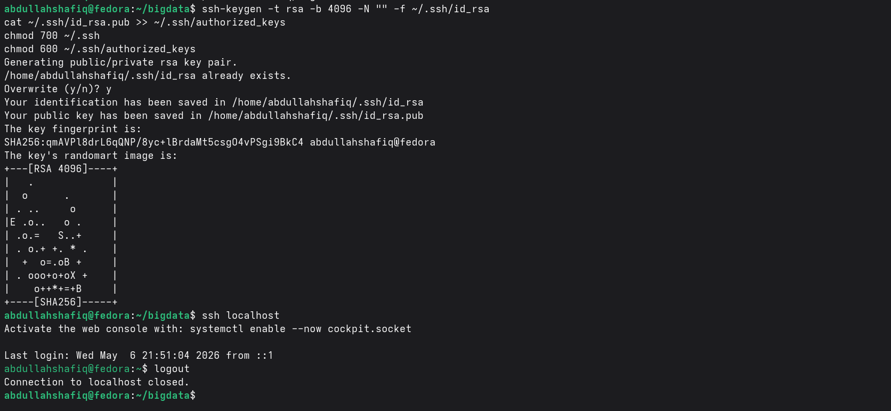 |
| Java Version | 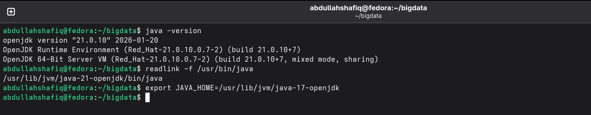 |
| Hadoop Version | 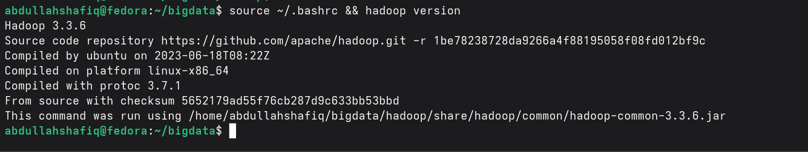 |
| NameNode Format | 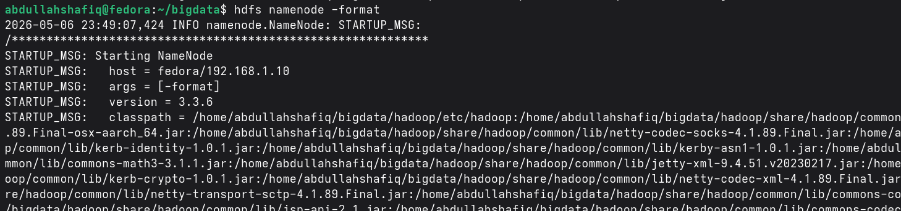 |
| Start Hadoop | 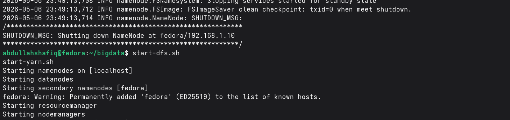 |
| JPS Processes | 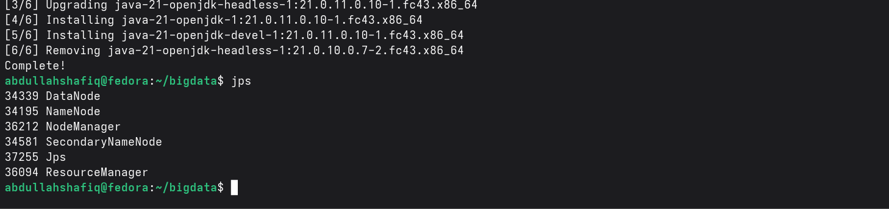 |
| WordCount Test | 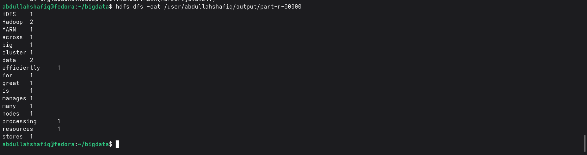 |
| PySpark Shell | 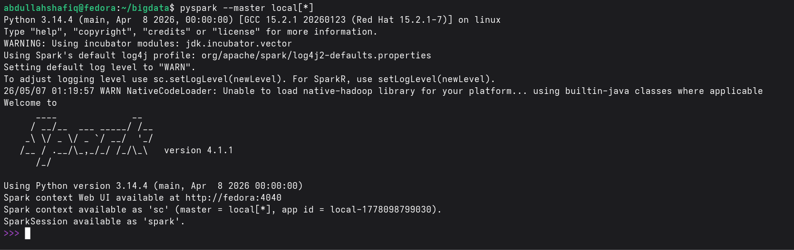 |
| PySpark DataFrame | 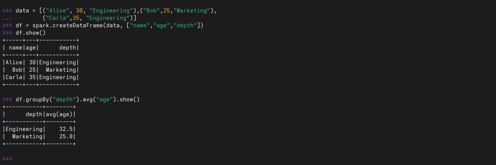 |
| NameNode UI | 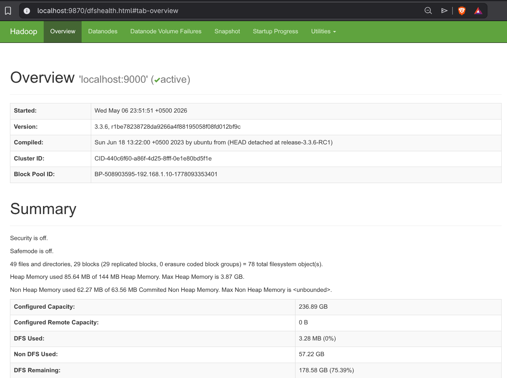 |
| YARN UI | 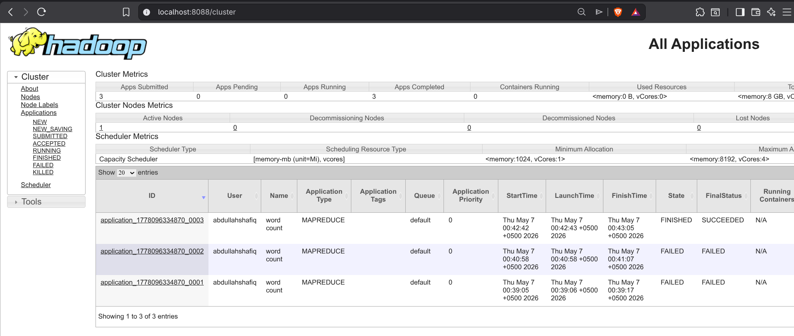 |
| Spark UI | 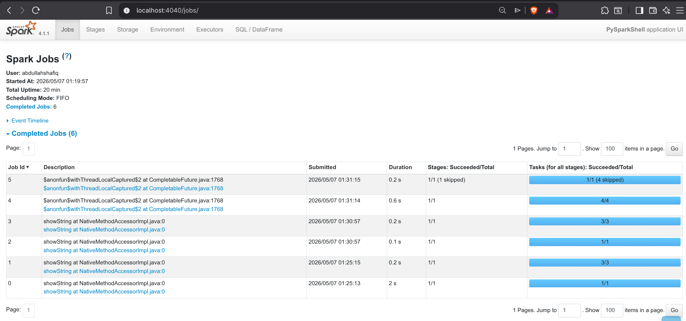 |

</details>

---

## 📄 License

This project is licensed under the **MIT License** — see the [LICENSE](LICENSE) file for details.

---

<p align="center">
  
</p>

<h3 align="center">Created with ❤️ by Abdullah Shafiq</h3>

<p align="center">
  <a href="https://github.com/AbdullahShafiqx">
    
  </a>
</p>
